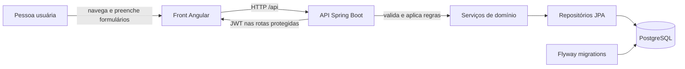

# SCM — Sistema de Controle para Microempreendedores Individuais

O SCM é um projeto integrador voltado ao apoio da rotina administrativa e financeira de MEIs. A proposta é reunir em uma aplicação o cadastro de clientes, serviços e fornecedores, o acompanhamento de lançamentos e obrigações do DAS e uma visão resumida da operação. Isso reduz a dispersão de informações e facilita o acompanhamento de recebimentos, documentos fiscais e vencimentos.

O repositório é dividido em `api/scm` (API REST em Java/Spring Boot) e `front/scm` (aplicação web Angular). A API aplica as regras de negócio e persiste os dados em PostgreSQL; o front oferece as telas e consome os endpoints via HTTP.

## Módulos

- Autenticação, cadastro de usuário e recuperação de senha.
- Clientes, com filtros, ativação/desativação e histórico de alterações.
- Serviços e fornecedores.
- Lançamentos financeiros vinculados a cliente, com status de recebimento e indicador de nota fiscal.
- Obrigações DAS vinculadas a cliente, com competência, vencimento, pagamento e consultas de próxima obrigação e séries mensais.
- Início/dashboard com indicadores consolidados.

## Fluxo da aplicação



## Executar com Docker

Requer Docker com Docker Compose. Na raiz do repositório:

```bash
docker compose up --build
```

Acesse o front em `http://localhost:4200`, a API em `http://localhost:8081` e o Swagger em `http://localhost:8081/swagger-ui/index.html`. O PostgreSQL fica disponível na porta `5432`. O Compose cria o schema pelas migrações Flyway e carrega dados demonstrativos idempotentes. O primeiro build pode demorar por baixar imagens e dependências.

Para encerrar mantendo os dados do banco, use `docker compose down`. Para apagar também o volume e recriar o banco do zero, use `docker compose down -v`.

## Execução local sem Docker

- API: entre em `api/scm`, configure PostgreSQL e as variáveis documentadas em [api/scm/README.md](api/scm/README.md), então execute `./mvnw spring-boot:run` (Windows: `mvnw.cmd spring-boot:run`).
- Front: entre em `front/scm`, use Node.js 24, execute `npm ci` e `npm start`. O proxy de desenvolvimento encaminha chamadas para `localhost:8081`.

## Documentação por componente

- [API: arquitetura, regras, endpoints e configuração](api/scm/README.md)
- [Front: telas, organização, integração e execução](front/scm/README.md)
- [Plano de importação de NFS-e XML](api/scm/PLANO_IMPORTACAO_NFSE_XML.txt)

## Observações

Os dados do seed são fictícios e servem para desenvolvimento/demonstração. O Compose usa credenciais e segredo JWT de desenvolvimento; substitua-os antes de qualquer implantação compartilhada ou produção. A recuperação de senha requer configuração de um servidor SMTP para envio real de e-mail.
