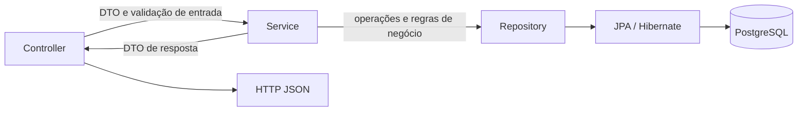

# API SCM

API REST responsável por autenticação, regras de negócio e persistência do SCM. Implementada em Java 17, Spring Boot, Spring Data JPA, Spring Security, JWT, Flyway e PostgreSQL. A porta padrão é `8081`.

## Arquitetura e fluxo de uma requisição



Controllers definem rotas e códigos HTTP; DTOs definem o formato da entrada e saída; services concentram decisões de negócio e transações; repositories encapsulam consultas; entities representam dados persistidos. `ErrorHandler` converte erros em respostas da API.

## Regras de negócio principais

- **Autenticação:** `AuthService` verifica credenciais, armazena senha codificada e emite JWT após login/cadastro. A recuperação invalida tokens anteriores não utilizados, gera token válido por 30 minutos e permite uso único. Em ambiente sem SMTP a implementação retorna o token no corpo para facilitar integração/testes; isso não deve ser exposto em produção.
- **Clientes:** criação registra evento de inclusão. Atualizações registram no histórico os campos alterados; mudança de ativo registra desativação/reativação. Exclusão é lógica: cliente ativo passa a inativo. O histórico identifica o usuário autenticado quando disponível.
- **Lançamentos:** todo lançamento precisa referenciar cliente existente. Listagem requer `clienteId` e aceita busca, status de recebimento, flag de nota fiscal e paginação. O CRUD está em `LancamentoService` e `LancamentoController`.
- **Obrigações DAS:** uma listagem deve escolher um cliente ou solicitar explicitamente registros sem vínculo (`semVinculo=true`), nunca ambos nem nenhum. Marcar uma guia como `PAGO` define a data de pagamento como a data atual; outros status limpam essa data. A próxima obrigação ignora as pagas e ordena por vencimento.
- **Dados e schema:** Flyway mantém migrações versionadas em `src/main/resources/db/migration`. O Hibernate está configurado com `ddl-auto=update`; alterações estruturais devem ser avaliadas junto às migrações para manter instalações existentes compatíveis.

## Endpoints

Os controllers oferecem os prefixos `/api/v1/...` e, em alguns recursos, aliases sem versão. Exemplos:

| Recurso | Rotas principais | Observações |
|---|---|---|
| Autenticação | `/auth/login`, `/auth/register`, `/auth/recuperar-senha-solicitar`, `/auth/recuperar-senha-confirmar` | Login e cadastro retornam JWT. |
| Clientes | `/api/v1/clientes` | CRUD, filtros e histórico; confira `ClienteController`. |
| Lançamentos | `/api/v1/lancamentos?clienteId={uuid}` | CRUD, busca e filtros. |
| Obrigações | `/api/v1/obrigacoes` | CRUD, filtro por competência/cliente, `semVinculo` e `/proxima`. |
| Demais módulos | `/api/v1/servicos`, `/api/v1/fornecedores`, `/api/v1/usuarios`, `/api/v1/dashboard` | Contratos detalhados no Swagger. |

A documentação interativa fica em `/swagger-ui/index.html`; o OpenAPI em `/v3/api-docs`. A configuração de segurança e o filtro JWT estão em `configs/security`.

## Arquivos para entender o código

- Inicialização e propriedades: `ScmApplication.java`, `src/main/resources/application.properties`.
- Rotas: `controllers/` (por exemplo `LancamentoController.java`, `GuiaDasController.java`).
- Regras: `services/` (por exemplo `AuthService.java`, `ClienteService.java`, `LancamentoService.java`, `GuiaDasService.java`).
- Contratos HTTP e modelo: `models/*/dtos/` e `models/`.
- Consultas/persistência: `repositorys/` (nome do pacote existente no projeto).
- Autenticação: `configs/security/SecurityConfig.java`, `JWTFilter.java`, `JWTUtil.java`.
- Tratamento de erros: `configs/exceptions/ErrorHandler.java` e `ValidacaoException.java`.
- Evolução do banco: `src/main/resources/db/migration/V*.sql`.
- Massa de demonstração: `scripts/seed_dados_teste.sql`.

## Executar localmente

Requisitos: Java 17, PostgreSQL e Maven (ou o wrapper Maven incluído). Crie um banco e defina, conforme necessário:

| Variável | Padrão local | Uso |
|---|---|---|
| `PSQLDB_URL` | `jdbc:postgresql://localhost:5432/postgres` | URL JDBC. |
| `PSQLDB_USERNAME` | `postgres` | Usuário do banco. |
| `PSQLDB_PASSWORD` | `postgres` | Senha do banco. |
| `SERVER_PORT` | `8081` | Porta HTTP. |
| `JWT_SECRET` | segredo de desenvolvimento | Assinatura JWT; use segredo forte fora do desenvolvimento. |
| `MEI_LIMITE_ANUAL` | `81000.00` | Limite anual utilizado nos cálculos do MEI. |
| `MAIL_HOST`, `MAIL_PORT`, `MAIL_USERNAME`, `MAIL_PASSWORD` | `localhost`, `1025`, vazios | SMTP para recuperação de senha. |

Execute na pasta `api/scm`:

```bash
./mvnw spring-boot:run
```

No Windows PowerShell: `.\mvnw.cmd spring-boot:run`. Para compilar: `./mvnw package`.

## Docker integrado

Na raiz do repositório, `docker compose up --build` sobe banco, API e front; o serviço `seed` aplica `scripts/seed_dados_teste.sql` após o Flyway criar as tabelas. O Compose é destinado ao desenvolvimento e usa credenciais locais demonstrativas.

