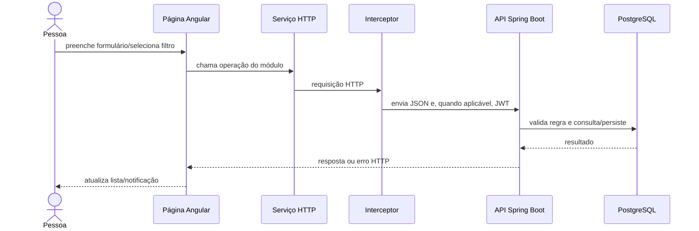

# Front SCM

Aplicação web do SCM implementada com Angular 19.2, TypeScript e RxJS. As páginas usam componentes standalone, rotas com carregamento sob demanda e serviços HTTP para integrar com a API Spring Boot.

## Organização

- `src/app/features/`: páginas agrupadas por módulo (`auth`, `inicio`, `cliente`, `servico`, `fornecedor`, `lancamento`, `obrigacao`, `usuario` e perfil).
- `src/app/core/`: estrutura compartilhada da aplicação, layout, guards, interceptors e sessão.
- `src/app/shared/`: componentes reutilizáveis, modelos, validadores, utilitários e serviços comuns.
- `src/app/app.routes.ts`: mapa das rotas e carregamento lazy.
- `src/app/app.config.ts`: configuração global e provedores Angular.
- `src/environments/`: configuração do endereço da API.

## Fluxo de tela até API



`AutenticacaoService` trata login, cadastro e recuperação de senha. `autenticacao-interceptor.ts` acrescenta o token nas chamadas protegidas; `auth-guard.ts` controla acesso às rotas. `notification-interceptor.ts` centraliza notificações de resposta/erro. As telas de domínio ficam em `features/<módulo>/pages/`; contratos usados pelo front estão em `shared/models/`.

## Rotas principais

- Públicas: `/login`, `/cadastro`, `/esqueci-minha-senha`, `/redefinir-senha`.
- Aplicação: `/inicio`, `/minha-conta`, `/lancamentos`, `/obrigacoes`, `/usuarios`, `/clientes`, `/servicos`, `/fornecedores`.

A fonte da configuração é `src/app/app.routes.ts`. O guard está em `src/app/core/guards/auth-guard.ts`.

## Executar localmente

Requisitos: Node.js 24 e npm. Na pasta `front/scm`:

```bash
npm ci
npm start
```

Abra `http://localhost:4200`. O `proxy.conf.json` encaminha `/api`, `/auth` e `/usuario` para `http://localhost:8081`, portanto a API deve estar em execução. Build de produção: `npm run build`.

## Executar pelo Docker Compose

Na raiz do repositório, execute `docker compose up --build`; o front fica em `http://localhost:4200`. O container usa Node 24 para instalar dependências e compilar a aplicação Angular 19. As chamadas `/api` são encaminhadas pelo servidor web para a API no Compose.

## Compatibilidade das versões

O ambiente solicitado usa Node.js 24 com Angular 19. A tabela oficial de compatibilidade do Angular 19.2 declara suporte a Node.js 18, 20 e 22, não 24; portanto o Dockerfile mantém Node 24 conforme o requisito do projeto, mas o build pode apresentar incompatibilidades. Se isso ocorrer, use Node 22 para o build ou atualize o Angular antes de padronizar Node 24. Angular 19 também já está fora da janela oficial de suporte. Consulte [compatibilidade de versões](https://angular.dev/reference/versions) e [ciclo de suporte](https://angular.dev/reference/releases).
## Configuração

O ambiente de desenvolvimento define `apiUrl: '/api'` em `src/environments/environment.development.ts`, permitindo proxy sem URL fixa no navegador. Credenciais, tokens e integração com serviços externos devem ser tratados pela API ou por configuração segura; não coloque segredos no bundle Angular.

